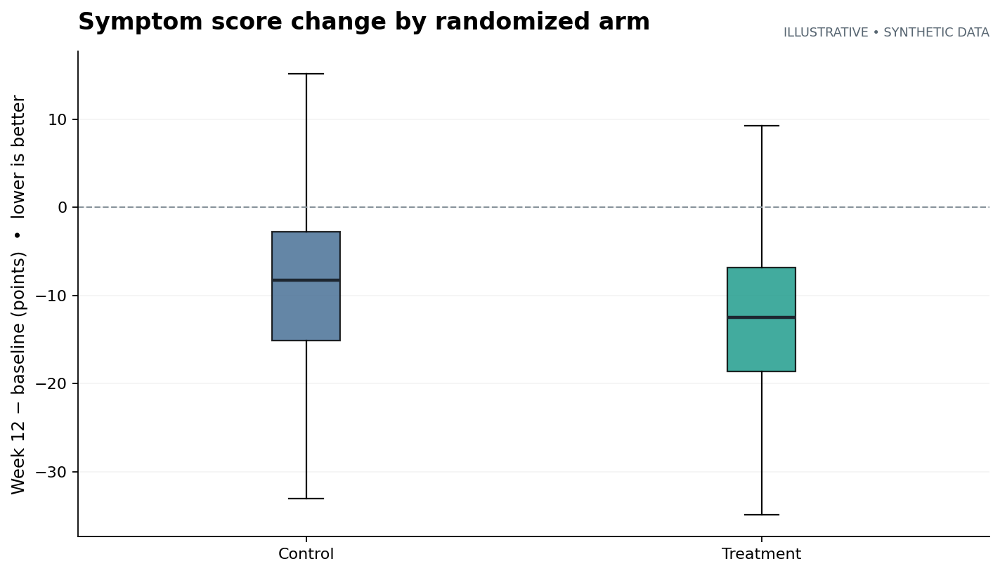
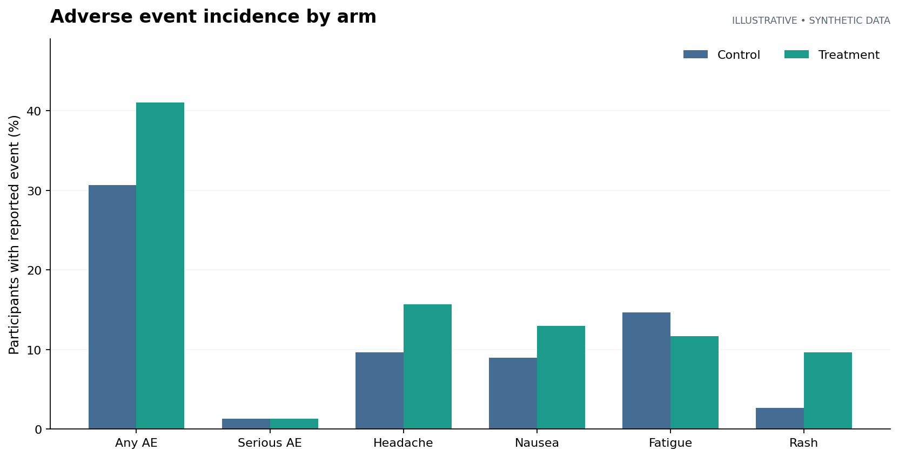

# Clinical Trial Efficacy & Safety Analysis Using R


A reproducible **biostatistics portfolio project** demonstrating the analytical workflow of a hypothetical, two-arm randomized clinical trial, from data quality checks to efficacy modeling, safety summaries, and Monte Carlo simulation.

> **Important:** This repository uses **fully synthetic, simulated participant records**. It is not a clinical study, not evidence of drug efficacy or safety, and does not contain real patient data. All outcomes, adverse events, and estimated effects are illustrative. The project is a learning and demonstration exercise, not validated software for regulated clinical research.

## Research question

In a hypothetical 12-week, randomized study with 1:1 allocation, does an experimental treatment reduce a continuous *symptom burden score* compared with control? What does its **simulated** adverse-event profile look like?

- **Design:** Parallel-group randomized simulation, 600 participants, 6 simulated sites.
- **Primary exploratory outcome:** Week-12 symptom score, where lower values are better.
- **Primary comparison:** Covariate-adjusted mean difference between Treatment and Control (ANCOVA).
- **Secondary outcome:** ≥12-point improvement from baseline (responder analysis).
- **Safety outcomes:** Any reported adverse event, serious adverse events, and four event categories.
- **Missingness:** Some week-12 symptom scores are missing; efficacy is analyzed among observed cases, with a simple baseline-observation-carried-forward sensitivity analysis.

## Analysis pipeline

```text
Synthetic participant-level CSV
          |
          v
Data integrity and consistency checks
          |
     +----+-----+
     |          |
     v          v
 Efficacy     Safety
 ANCOVA       Incidence + Wilson CIs
 Responder    Risk difference / risk ratio
 Sensitivity  Fisher's exact test
     |          |
     +----+-----+
          |
          v
 Tables + figures + optional HTML report
          |
          v
 Monte Carlo scenario simulation
```

## Quick start

Install [R](https://cran.r-project.org/) (R 4.2 or newer recommended), then from the **root folder of this repository** run:

```bash
Rscript run_all.R
```

This generates CSV tables under `outputs/tables/` and PNG figures under `outputs/figures/` using **base R only**. The bundled `data/synthetic_trial.csv` is ready to analyze immediately.

To optionally create an HTML report (requires `rmarkdown`, `knitr`, and Pandoc, available through RStudio):

```r
install.packages(c("rmarkdown", "knitr"))
rmarkdown::render("reports/clinical_trial_report.Rmd",
                  output_file = "clinical_trial_report.html",
                  output_dir = "outputs")
```

A [sample rendered HTML report](reports/clinical_trial_report.html) is included for review.
Download this HTML file and open it in a web browser to view its embedded charts.
The report hides analysis code while preserving output tables and charts, and
formats p-values below 0.0001 as `p < 0.0001` rather than displaying `0`.
The source is `reports/clinical_trial_report.Rmd`; rerunning `run_all.R` regenerates
an updated HTML copy under `outputs/`.

To regenerate a **different** deterministic synthetic dataset in R (overwrites the provided CSV) and rerun all analyses:

```bash
Rscript R/generate_synthetic_data.R
Rscript run_all.R
```

To run the lightweight quality checks:

```bash
Rscript tests/test_pipeline.R
```

> The provided CSV is one fixed synthetic example. The R simulation script is an independent, seeded dataset generator built around the same design parameters, and will produce **different** synthetic participant values than the bundled example.

## Preview: simulated data only

| Continuous efficacy | Safety incidence |
|:--:|:--:|
|  |  |

*These preview figures illustrate the bundled synthetic CSV. The R analysis creates its own charts after you run `run_all.R`.*

## Statistical methods

| Component | Approach | Interpretation / caveat |
|---|---|---|
| Primary efficacy | ANCOVA: `week12_score ~ arm + baseline_score + age + sex + site` | Adjusted treatment minus control mean difference, 95% CI; negative favors treatment |
| Responder analysis | Logistic regression for ≥12-point improvement | Adjusted odds ratio, approximate Wald CI; observed outcomes only |
| Missing-data sensitivity | Baseline observation carried forward (BOCF) | Simple stress test, **not** a generally valid replacement for missing-data modeling |
| Safety | Frequencies, percentages, Wilson 95% intervals | Includes all randomized simulated participants; descriptive |
| Main safety contrast | Risk difference, risk ratio, two-sided Fisher's exact test | Exploratory comparison of any AE; not powered for safety conclusions |
| Simulation | Repeated synthetic ANCOVA trials, three effect scenarios | Estimates rejection probability and its Monte Carlo standard error under simplified assumptions |

**Study design note:** The dataset is constructed to contain an illustrative efficacy signal and some differing adverse-event probabilities. Significant results are expected by design in some scenarios and must **not** be interpreted as evidence about a real treatment. The statistical models are educational examples rather than a prespecified regulatory statistical analysis plan.

## Directory layout

```text
clinical-trial-efficacy-safety-r/
├── .github/workflows/r-check.yml       # Automated pipeline checks on GitHub
├── R/
│   ├── helpers.R                        # Validation, IO, Wilson intervals
│   ├── generate_synthetic_data.R       # Seeded simulated data generator
│   ├── analyze_efficacy.R              # ANCOVA, responder, sensitivity
│   ├── analyze_safety.R                # Adverse event summaries
│   ├── power_simulation.R              # Monte Carlo scenarios
│   └── plots.R                         # Base R visualizations
├── data/
│   └── synthetic_trial.csv             # Simulated dataset, no PHI
├── docs/
│   ├── data_dictionary.md              # Variables, types, definitions
│   ├── analysis_plan.md                # Endpoints, populations, limitations
│   ├── project_walkthrough.md          # Explanation for interviews
│   └── assets/                         # Illustrative preview plots
├── reports/
│   └── clinical_trial_report.Rmd       # Optional knitted analysis report
├── tests/
│   └── test_pipeline.R                 # Base R consistency checks
├── outputs/                             # Recreated on execution
├── run_all.R                            # One-command pipeline
├── ClinicalTrialAnalysis.Rproj         # RStudio project
└── README.md
```

## What this project demonstrates

- R programming with structured, readable analytical functions and data validation.
- Clinical trial concepts, endpoints, treatment contrasts, adjustment, and missing data.
- Efficacy analysis using linear and generalized linear models.
- Descriptive safety analysis, uncertainty intervals, and careful interpretation.
- Simulation-based evaluation of operating characteristics.
- Version-control-ready structure, automated checks, and reproducible reporting.

## Next improvements

1. Replace the **simulation-only** dataset with a documented, ethically shareable, publicly available clinical-trial dataset, *if* it includes appropriate efficacy and safety measures and has clear reuse permission.
2. Implement a missing-at-random analysis using multiple imputation and sensitivity to missing-not-at-random assumptions.
3. Add longitudinal models, multiplicity control, and more realistic safety follow-up/exposure assumptions.
4. Add meta-analysis as an **independent extension** using published, licensed study-level data.
5. Add unit tests for statistical edge cases and a reproducible R dependency lockfile when external packages become necessary.

## License and ethics

MIT license covers original code and documentation. The synthetic dataset is fictional. **Never upload identifiable health records or protected health information to GitHub.**

## Real Clinical Trial Analysis: Prostate Cancer

**Project:** PSA Biomarker and Survival Analysis of Randomized Prostate Cancer Trials

Analyzed historical clinical trial data from 412 patients across 17 randomized studies using R.

**Statistical methods:**
- Trial-adjusted linear regression for PSA comparisons
- Kaplan-Meier survival estimation
- Trial-stratified Cox proportional hazards regression
- Schoenfeld residual diagnostics
- Exploratory time-varying treatment effect modeling

**Key findings:** The trial-adjusted PSA analysis identified a treatment-group difference (p = 0.0314). The constant-hazard-ratio survival model did not establish an overall survival benefit (HR = 0.991, p = 0.9414), while the proportional hazards diagnostic suggested possible non-proportionality (p = 0.0178).

This is an exploratory analysis of historical research data, not a clinical treatment recommendation.

[View analysis code](real_data/prostate_trial/run_prostate_report.R)

[View prostate cancer research report file](real_data/prostate_trial/published/prostate_cancer_report.html)

[Original dataset source](https://search.r-project.org/CRAN/refmans/Surrogate/html/prostate.html)
